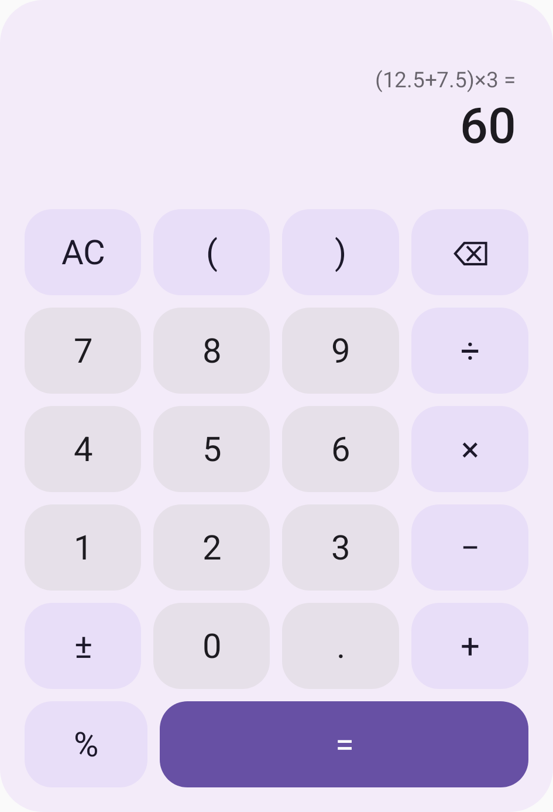
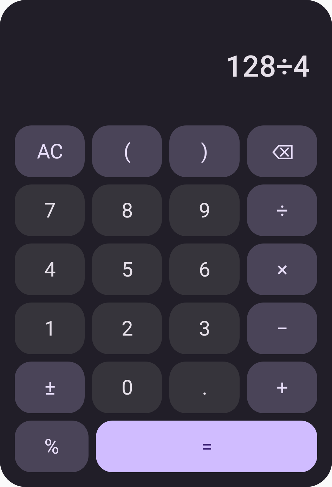

# Compose Calculator

[GitHub: katsuki-a/compose-calculator](https://github.com/katsuki-a/compose-calculator)

A calculator library for Android and Jetpack Compose, with separate calculation, state management, and UI layers.

- `calculator-core`: Android-independent Kotlin/JVM decimal engine and pure state reducer
- `calculator-compose`: Material 3 calculator UI, saveable controller, and English accessibility labels
- `sample`: Android app demonstrating the library

## Screenshots

| Light theme | Dark theme |
| --- | --- |
|  |  |

These images were rendered using Compose Preview. See also the [running sample app](docs/previews/sample.png) and [error state with large text](docs/previews/error.png).

## Quick start

```kotlin
import androidx.compose.material3.MaterialTheme
import androidx.compose.runtime.Composable
import dev.calculator.compose.Calculator

@Composable
fun CalculatorScreen() {
    MaterialTheme {
        Calculator(onResult = { value ->
            // value: java.math.BigDecimal
        })
    }
}
```

`Calculator()` provides a saveable controller and a callback for successful calculations. See the [state and callback contract](docs/spec.md#state-and-callback-contract) for restoration and notification behavior.

## Installation

The library has not been published to a public Maven repository. A local Maven repository is included in `distribution/maven/`. Compose and other dependencies are resolved from Google Maven and Maven Central.

### Use the included Maven repository

Add the path to the extracted repository in your host project's `settings.gradle.kts`:

```kotlin
dependencyResolutionManagement {
    repositories {
        google()
        mavenCentral()
        maven { url = uri("/path/to/compose-calculator/distribution/maven") }
    }
}
```

Add the dependency to your app module:

```kotlin
dependencies {
    implementation("dev.calculator:calculator-compose:0.1.0")
}
```

`calculator-core` is resolved transitively. For calculation without the UI, use `dev.calculator:calculator-core:0.1.0` alone. Adding an AAR file directly does not resolve its dependencies automatically; use the Maven repository or source modules instead.

### Use the source modules

Use `calculator-core/` and `calculator-compose/` along with the root Gradle configuration and version catalog. The included sample uses `implementation(project(":calculator-compose"))`. When copying the modules into an existing project, merge their dependency and plugin definitions into the host's version catalog.

### Build requirements

- Android minSdk 23, compileSdk 37, and sample targetSdk 37
- Gradle 9.6.0 / Android Gradle Plugin 9.4.1 / Kotlin and Compose Compiler Plugin 2.3.20
- Compose BOM 2026.03.01 / Material 3
- JDK 17 or later to run Gradle, with Kotlin/JVM toolchain 17
- Configure the Android SDK in Android Studio or set `sdk.dir=...` in `local.properties`

Enable Compose in the host app and apply a Compose Compiler Plugin matching its Kotlin version. Dependency versions are pinned to the verified configuration. Validate compatibility separately when using a different Compose version in the host.

## Manage state

```kotlin
val controller = rememberCalculatorController()
Calculator(controller = controller)
Button(onClick = { controller.dispatch(CalculatorAction.Clear) }) {
    Text("Clear")
}
val currentState = controller.state
```

Dispatch controller actions on the UI thread. See the [state and callback contract](docs/spec.md#state-and-callback-contract) for initialization and restoration rules.

Use the stateless overload when a ViewModel or another host component owns the state:

```kotlin
@Composable
fun HostedCalculator() {
    // remember retains state only within the Composition.
    // Use SavedStateHandle or another host mechanism for activity recreation.
    var state by remember { mutableStateOf(CalculatorState()) }
    Calculator(
        state = state,
        onAction = { action -> state = CalculatorReducer.reduce(state, action) },
    )
}
```

Import `androidx.compose.runtime.*`, `dev.calculator.core.*`, and `dev.calculator.compose.Calculator` for this example. The stateless overload emits `onAction`; the host handles calculation, persistence, and result notifications.

## Customize the UI

```kotlin
Calculator(
    modifier = Modifier.fillMaxWidth(),
    colors = CalculatorDefaults.colors().copy(
        equalsContainer = Color(0xFF006C4C),
        equalsContent = Color.White,
    ),
    labels = CalculatorDefaults.labels().copy(clear = "Clear input"),
)
```

The calculator follows `MaterialTheme` colors and typography. See the [UI specification](docs/spec.md#ui-and-localization) for dimensions, scrolling, and host layout constraints.

Customize English labels and error messages through `CalculatorLabels`. Supported input and feature limits are listed in the [specification](docs/spec.md).

## Use the calculation engine

```kotlin
when (val result = CalculatorEngine.evaluate("(12.5+7.5)*3")) {
    is CalculationResult.Success -> println(result.formatted) // "60"
    is CalculationResult.Failure -> println(result.error)
}
```

## Specification

The engine calculates with 34 significant digits, while results display at most 12 significant digits. See [docs/spec.md](docs/spec.md) for the complete calculation, rounding, key behavior, state, and UI specification.

## Design lessons

[What building a calculator teaches about library requirements](docs/library-requirements.md) explains calculator behavior, Compose integration, Android distribution, verification limits, and future maintenance work, with concrete examples and self-check questions.

## Verification and distribution

```sh
./gradlew :calculator-core:test :calculator-compose:assembleRelease :sample:assembleDebug
./gradlew :calculator-compose:lintRelease :sample:lintDebug
# Connect an emulator or device before running UI tests
./gradlew :calculator-compose:connectedDebugAndroidTest
# Regenerate the distribution Maven repository
./gradlew publishAllPublicationsToDistributionRepository
# Optionally publish to your development environment's mavenLocal
./gradlew publishToMavenLocal
```

Open `CalculatorPreview.kt` in Android Studio to inspect light, dark, large-text error, and repeating-result previews. See [VALIDATION.md](VALIDATION.md) for completed checks and images.

## License

MIT. See [LICENSE](LICENSE).
