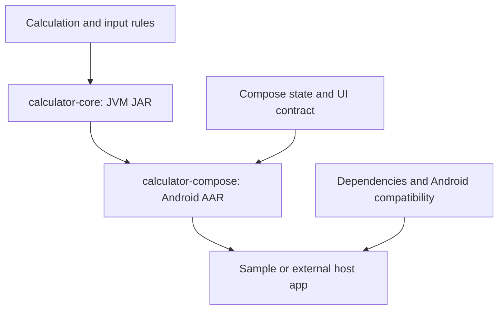

# What building a calculator teaches about library requirements

A library needs a clear contract for its behavior, a way to fit into its host, and evidence that its distributed artifact works. Building a calculator exposes all three at once.

This guide explains the decisions behind this project. [spec.md](spec.md) is the normative behavior specification; this document explains why those requirements matter and which lessons apply to other libraries.

**Evidence boundary:** source and artifact review on October 16, 2026, against baseline commit [06d91a6](https://github.com/katsuki-a/compose-calculator/commit/06d91a6). The 73 core tests and seven UI tests are results recorded on October 15 in [VALIDATION.md](../VALIDATION.md); they were not rerun for this documentation change. A requirement, this project's chosen policy, and a completed verification are different things.

## 1. Three layers of responsibility

| Layer | Question the author must answer | Example from this project |
| --- | --- | --- |
| Calculator | What do a number, an operation, and a key press mean? | Percent behavior, evaluation order, rounding, and error recovery |
| Compose library | How can another app own, display, and interact with that behavior? | Stateless API, saveable controller, Modifier, theme, and callbacks |
| Android library | Can another Android project obtain, build, run, and upgrade it? | AAR/JAR, dependencies, SDK requirements, release behavior, and compatibility |

These requirements accumulate. A Compose calculator for Android must satisfy all three. A parser without a UI needs the first layer; an Android image component still needs the last two.



A runnable sample demonstrates one integration. A reusable library must also make its assumptions explicit to callers the author has never met.

## 2. Calculator requirements: define numerical and interaction meaning

### 2.1 Arithmetic needs a specification before it needs buttons

Consider `2+3*4`. An expression calculator can apply precedence and return `14`; an immediate-execution calculator can follow a different interaction model. The requirement is to select and document the intended model. This project uses expression evaluation with precedence.

The same issue appears with `%`. This project defines postfix percent as division by 100, so `200+10%` is `200.1`. A product that interprets that input as a percentage increase would return `220`. Neither behavior should be left to accidental implementation details.

| Requirement | Why it matters | This project's policy |
| --- | --- | --- |
| Supported grammar | Callers need to know what input is accepted | Decimal numbers, unary signs, parentheses, four operations, postfix percent |
| Evaluation order | Identical expressions must have predictable results | Precedence; left associativity within the same binary precedence level |
| Numeric representation and precision | A result needs defined error and rounding behavior | Decimal strings parsed into BigDecimal; DECIMAL128 arithmetic |
| Display policy | A readable result should not silently become the next calculation's input | 12 significant digits, separate from the engine value |
| Failure and recovery | Users must be able to correct an invalid expression | Typed failures; digit entry starts over after error; backspace edits the original expression |
| Resource bounds | Excessive input should be rejected predictably | 512-character expression limit and a recursive depth limit |

**General requirement:** define these policies. **Project choices:** 12 display digits, 34 calculation digits, ratio-style percent, and the specific input limits. These are not universal calculator standards. A currency calculator, scientific calculator, or exact rational calculator may require different policies.

See [CalculatorEngine.kt](../calculator-core/src/main/kotlin/dev/calculator/core/CalculatorEngine.kt) and [spec.md](spec.md#calculation-semantics).

### 2.2 A number and its display string have different jobs

The clearest lesson emerged from `1/3`:

| Representation | Value or text | Purpose |
| --- | --- | --- |
| Engine value | `0.3333333333333333333333333333333333` | Continued arithmetic and the result callback |
| Display string | `≈ 0.333333333333` | Human-readable UI |

If the app multiplies the display string's numeric portion by three, it computes from an already shortened value. This project instead keeps the engine value in `CalculatorState.result`; `display` applies `CalculatorResultFormatter` only for presentation. The formatter can emit `≈` and scientific notation, neither of which should be treated as a canonical expression value.

The key sequence `1 / 3 = × 3 =` illustrates a second boundary: BigDecimal does not make every calculation exact. DECIMAL128 retains finite precision, so the stored result is `0.9999999999999999999999999999999999`, displayed as `≈ 1`. Here, “unrounded value” means “before display rounding,” not “an exact mathematical rational number.”

The approximation mark reports a difference introduced by display rounding. It does not prove that an unmarked value has no error from earlier engine arithmetic.

A complete display contract answers all of these:

- Significant digits or fractional digits? Here, 12 significant digits count both integer and fractional parts; leading zeros do not count.
- Which tie rule? HALF_EVEN, including negative values.
- What about tiny values? Scientific notation prevents a nonzero value from becoming a displayed zero merely because of fixed fractional places.
- What happens at a carry? Select plain or scientific notation after rounding.
- What do trailing zeros and negative zero look like? Unnecessary fractional zeros are removed; zero displays as `0`.
- Does an exact but long integer follow the same policy? Yes; presentation is consistent across result types.

See [the formatter](../calculator-core/src/main/kotlin/dev/calculator/core/CalculatorResultFormatter.kt), [its boundary tests](../calculator-core/src/test/kotlin/dev/calculator/core/CalculatorResultFormatterTest.kt), and [the display specification](spec.md#result-display-precision).

### 2.3 The keypad is a state machine

“Accept digits and operators” is insufficient. Pressing `7` after a result starts a new calculation; pressing `+` continues from the result. Pressing backspace after an error edits the failed expression. These are state transitions.

The reducer expresses that contract as:

```text
(current state, action) -> next state
```

`CalculatorReducer` owns those transitions without Android or Compose. That makes sequences such as sign changes, operator replacement, repeated equals, and recovery testable independently of drawing buttons.

The expression API and keypad also need distinct contracts. The engine rejects `2(3)`; the keypad inserts `*` when the user opens a parenthesis after a completed operand. A convenience in the UI does not imply that the parser accepts that syntax.

Useful tests state a rule rather than repeat the implementation: `2+3*4=14`, `200+10%=200.1`, `1/0` returns a typed error, and continuation uses the stored result rather than the shortened display. A statement such as “many tests pass” is weaker than being able to name which promises those tests protect.

## 3. Compose library requirements: let the host integrate the behavior

### 3.1 Offer a clear state owner

This project provides two entry points:

```kotlin
// Convenient default: the controller owns the calculator state.
Calculator(controller = rememberCalculatorController())

// Integration point: the host owns state and processes actions.
Calculator(state = state, onAction = onAction)
```

The first works for a simple screen. The second lets a host coordinate a form, a ViewModel, persistence, or other business logic without keeping a second competing copy of the calculator state. State ownership should follow actual read/write responsibilities. See [Android's state-hoisting guidance](https://developer.android.com/develop/ui/compose/state-hoisting).

The library does not need to impose the host's navigation, dependency injection framework, Activity, or ViewModel class. It needs an explicit boundary through which the host can supply state and receive actions.

### 3.2 Define lifetime and events separately

`remember` and saved state solve different lifetime problems. This project uses `rememberSaveable` plus a Saver for the small canonical state: expression, result, result mode, and error. It does not persist a permanent calculation history. ViewModel alone also does not preserve data through system process death; a suitable saved-state or persistence mechanism is still needed. See [Compose state saving](https://developer.android.com/develop/ui/compose/state-saving).

The result callback is an event, not the act of displaying a value. Here, it fires after a successful Equals transition. Recomposition, state restoration, and a repeated Equals press on an unchanged result do not repeat that event.

This matters when a host uses the callback to update a form or save a value. Code placed directly in a composable body could repeat when Compose evaluates that body again. The current callback is dispatched from the action handler, while the stateless overload emits actions for the host to interpret.

Read [CalculatorController.kt](../calculator-compose/src/main/kotlin/dev/calculator/compose/CalculatorController.kt) and the two overloads in [Calculator.kt](../calculator-compose/src/main/kotlin/dev/calculator/compose/Calculator.kt).

### 3.3 Accept the host's layout and design

A reusable component needs a standard `Modifier` parameter, meaningful defaults, and a sensible boundary for drawing its content. Its caller should be able to size and position it. Theme and labels should also be customizable where consumers need those decisions.

This implementation accepts a Modifier, takes colors and typography from MaterialTheme, and exposes colors and labels. Its 420dp maximum width and 56dp key height are project policies, not Compose requirements. Its vertical scroll requires a bounded height, especially when embedded in another vertical scrolling container; that integration assumption is documented.

Stability annotations are contracts, not switches that make arbitrary objects efficient. `@Stable` on this controller relies on observable state changes through `mutableStateOf`; the immutable color and label objects make different promises. An annotation cannot compensate for hidden mutation. These design rules follow the [Compose API guidelines](https://android.googlesource.com/platform/frameworks/support/+/androidx-main/compose/docs/compose-api-guidelines.md).

### 3.4 Make the UI understandable and verifiable

A visible `÷` should have an understandable accessibility label. Errors and results should be exposed to accessibility services. This project supplies labels and live-region semantics, but it has not completed TalkBack speech and navigation testing. Semantics expose meaning; they are not proof of a successful assistive-technology experience. See [Compose semantics](https://developer.android.com/develop/ui/compose/accessibility/semantics).

The evidence also depends on the question:

| Question | Useful evidence in this project | Limit |
| --- | --- | --- |
| Is text clipped in the inspected configuration? | Fresh Preview image and visual inspection | Does not establish every size, font scale, or locale |
| Does tapping produce the right value? | Instrumented Compose UI test | Covers the tested actions and device |
| Does saved state retain the canonical result? | StateRestorationTester and continuation assertions | Does not simulate actual OS process termination |
| Does a result callback preserve precision? | Callback assertion against BigDecimal | A screenshot cannot demonstrate this |

During the rounding change, an initial Preview still displayed old compiled behavior. Rebuilding in Android Studio and inspecting the new image and semantics resolved it. File creation or exit status alone would have been misleading.

## 4. Android library requirements: make the artifact consumable and maintainable

### 4.1 Distribute behavior together with dependency information

`calculator-core` produces a JVM JAR. `calculator-compose` produces an Android AAR, including Android resources and its manifest. Its core dependency is a separate artifact resolved through metadata, not a promise that copying one AAR supplies the complete dependency graph.

The publication includes release artifacts, source JARs, POMs, Gradle module metadata, and checksums in `distribution/maven/`. Release variant configuration is explained by [Android's publication guide](https://developer.android.com/build/publish-library/configure-pub-variants).

Source and artifact integration exercise different paths. The sample's `project(":calculator-compose")` dependency checks the module path. Building an independent consumer from `dev.calculator:calculator-compose:0.1.0` checks the Maven artifact and its transitive dependencies. The latter was also verified, as recorded in VALIDATION.md.

GitHub source publication, an included local Maven repository, a hosted Maven endpoint, and a production release are separate deliverables. The first two exist here; publication to Maven Central does not.

### 4.2 Distinguish device requirements from build requirements

The inspected library declares `minSdk=23`; the inspected AAR metadata declares `minCompileSdk=37`. They answer different questions:

| Setting | Meaning for this project |
| --- | --- |
| minSdk 23 | The library's declared minimum Android platform version; this minimum was not exercised on a device |
| AAR minCompileSdk 37 | The consumer needs compileSdk 37 or later, also subject to dependency constraints |
| Sample targetSdk 37 | The sample opts into platform behavior associated with that target; the host owns its own target setting |
| Producer AGP/Kotlin/JDK versions | The toolchain used to build this project; this is not a verified matrix of every consumer toolchain |

A consumer compiling against SDK 37 can still support devices below API 37 if its code and dependencies support them. Conversely, declaring minSdk 23 is not evidence that execution on API 23 has been tested. Android's [library documentation](https://developer.android.com/studio/projects/android-library) also describes how library platform and resource constraints affect consumers.

The observed minCompileSdk value is an artifact fact, not a guess from the source project's compileSdk. Future releases should inspect and document their actual metadata again.

### 4.3 Treat dependencies and resources as part of the API boundary

Use `api` when a dependency's types are part of the exposed contract; use `implementation` for internal use. An implementation dependency can still be needed at runtime. See [Gradle's API/implementation separation](https://docs.gradle.org/current/userguide/java_library_plugin.html#sec:java_library_separation).

Here, `CalculatorState` appears in the Compose API, so core is an API dependency. Public signatures also contain Compose types such as Modifier and Color. Foundation is an implementation dependency. Those choices should be reviewed when public signatures change.

Library resources can affect the host through resource merging. This project prefixes strings with `calculator_` and declares no permissions or components in its own manifest. That reduces integration burden; it does not eliminate the need to inspect dependency contributions and merged artifacts. A deliberate public-resource surface is still a follow-up item: there is no `public.xml` here.

A release review should also ask whether shrinking changes behavior. This project has not verified a minified release consumer. Add consumer keep rules only for actual needs such as reflective entry points, and test them in a real consumer instead of keeping every class. See [optimization for library authors](https://developer.android.com/topic/performance/app-optimization/library-optimization).

### 4.4 Plan upgrades as carefully as initial installation

A public signature is a promise to existing callers. Compatibility has source, binary, and behavioral dimensions. A new default parameter can leave some source calls valid while changing a JVM signature; a percentage-policy change can preserve signatures while changing results. See [Kotlin library compatibility guidance](https://kotlinlang.org/docs/api-guidelines-backward-compatibility.html).

The current project has no API baseline checks, CI workflow, or release tags. Before treating it as a stable external dependency, define versioning and deprecation policies, automate compatibility checks, and verify a consumer upgrade. Published release coordinates should identify immutable artifacts; regenerating a development distribution at the same `0.1.0` path is not a release-management policy to carry forward.

## 5. Current evidence and remaining work

| Area | Evidence already available | Still to establish |
| --- | --- | --- |
| Calculator rules | Specification; 73 recorded core tests | Domain-specific policies if reused for money, science, or exact arithmetic |
| State and callbacks | Seven recorded UI tests, including restored precision and event behavior | Actual OS process-death scenario |
| Appearance | Inspected light, dark, error, and repeating-result previews | Broader size/font/locale matrix and TalkBack validation |
| Consumption | Independent Maven consumer built successfully | Broader Kotlin/Compose/AGP compatibility matrix |
| Android execution | Instrumented run on API 36 | Runtime verification at minSdk and on current target-platform devices |
| Release behavior | AAR/JAR and dependency metadata generated | Minified consumer, public-resource policy, immutable versioned releases |
| Maintenance | English docs, source, sample, and MIT license | CI, API baselines, changelog, and deprecation policy |

A useful next sequence is: automate the existing tests and consumer build; add minSdk and minified-consumer coverage; establish API/versioning checks; then expand platform, accessibility, and appearance coverage according to intended users. This is a recommendation, not work completed by this documentation change.

## 6. Check your understanding

Try explaining each answer before opening the model answer. A good answer names the responsible layer, the failure it prevents, and a concrete way to verify it. If it only names a tool, revisit the linked section and explain the scenario again.

<details>
<summary>1. Why not compute the next operation from the displayed 12 digits?</summary>

The display is rounded and may contain an approximation mark or scientific notation. The calculator must retain a canonical engine value for continuation and callbacks. Verify this with the `1/3 = ×3 =` sequence, including restoration between operations. See section 2.2.
</details>

<details>
<summary>2. Is 12 significant digits a requirement for every calculator library?</summary>

No. Defining a consistent precision contract is the requirement; 12 digits is this project's policy. Required accuracy, display constraints, and the target domain determine that policy. See section 2.1.
</details>

<details>
<summary>3. Why offer both a controller and a stateless Compose API?</summary>

A controller makes simple integration convenient. The stateless API lets the host own state and coordinate other business logic without a second source of truth. Verify that it emits actions and renders host-supplied state. See section 3.1.
</details>

<details>
<summary>4. Does a successful Preview prove restoration or callback correctness?</summary>

No. It shows static appearance for one rendered state. Restoration and callbacks need behavioral assertions. Saved-state emulation also does not establish actual OS process-death behavior. See sections 3.2 and 3.4.
</details>

<details>
<summary>5. Does minCompileSdk 37 require every user's device to run API 37?</summary>

No. It constrains the consumer's build SDK, while minSdk constrains the declared device baseline. Test both build compatibility and runtime behavior at the supported device versions. See section 4.2.
</details>

<details>
<summary>6. Why can an app fail when it copies the AAR although the sample works?</summary>

The sample may resolve project and transitive dependencies that the copied AAR alone does not supply. Test an independent consumer through the published metadata. See section 4.1.
</details>

<details>
<summary>7. Is implementation a way to remove a dependency from runtime?</summary>

No. It hides that dependency from the consumer's compile API surface when appropriate; runtime dependencies still matter. Inspect the resolved dependency graph and the distributed metadata. See section 4.3.
</details>

<details>
<summary>8. If adding a default parameter still lets the sample compile, is the API compatible?</summary>

That checks one source consumer. It does not prove compatibility with already compiled callers or preserve every behavior. Compare API baselines and test an upgrade from an older consumer. See section 4.4.
</details>

## 7. A reusable review template

For a future library, fill in these sentences before choosing implementation details:

1. **Domain contract:** Given ___ input or action, the result is ___; precision and failures mean ___.
2. **State contract:** ___ owns state; it survives ___; ___ causes a callback, while ___ does not.
3. **UI contract:** The host controls ___; accessibility and layout assumptions are ___.
4. **Distribution contract:** Consumers obtain ___ artifacts and ___ dependencies under ___ compatibility constraints.
5. **Upgrade contract:** A release can change ___; incompatible changes require ___.
6. **Evidence:** ___ tests or consumer scenarios establish these claims; ___ remains unverified.

For this calculator, those statements map to the engine and reducer, Compose controller and UI, and Maven/Android artifact checks. The transferable lesson is to document the promises, isolate who owns each one, and verify them at the boundary where a consumer relies on them.
